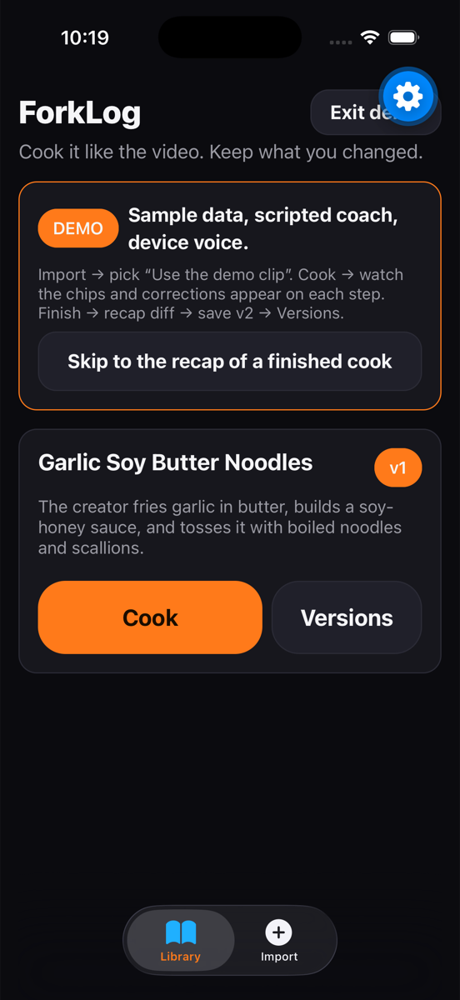
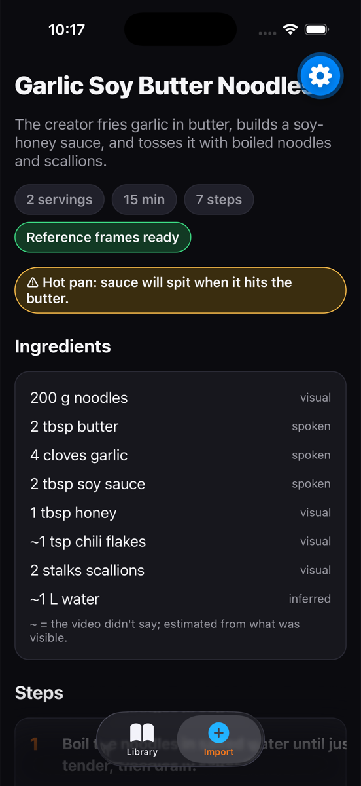
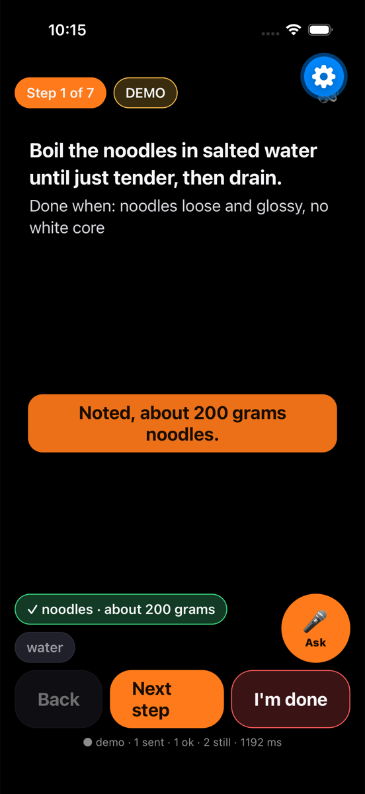
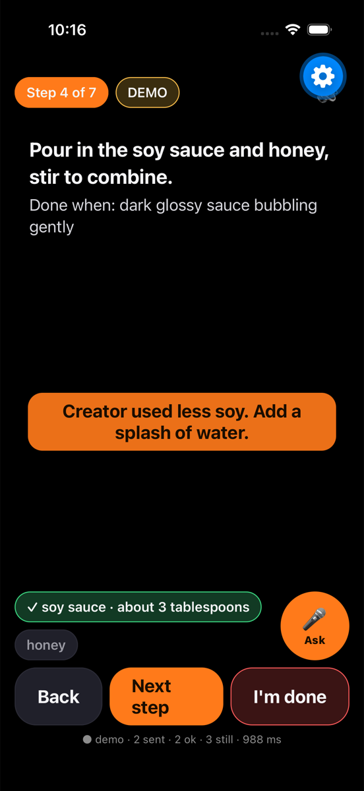
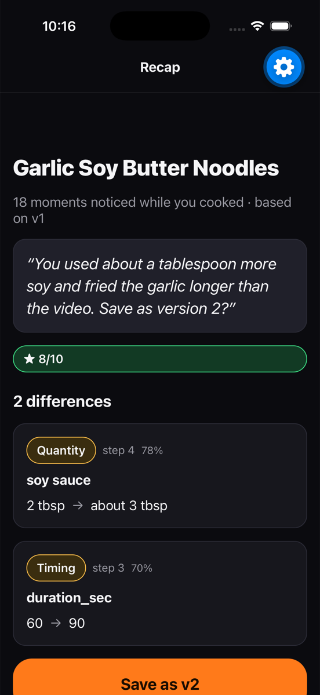
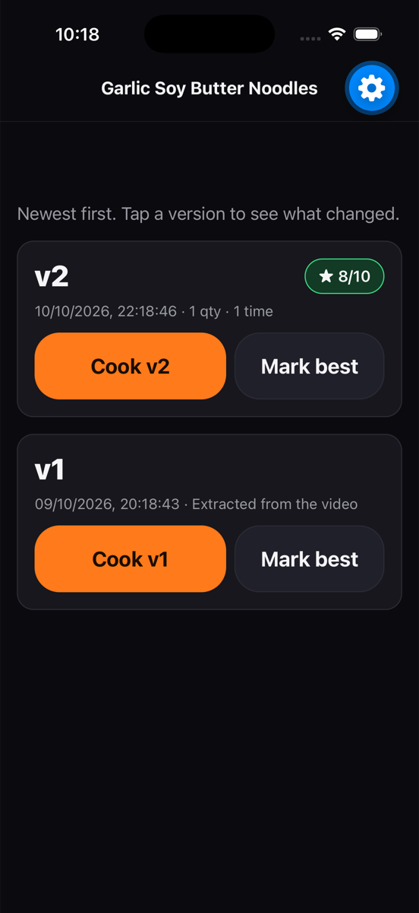

# Demo mode

ForkLog runs end to end with **no backend** when `EXPO_PUBLIC_SUPABASE_URL` / `EXPO_PUBLIC_SUPABASE_ANON_KEY` are missing from `.env`, or when you tap **Demo** on the Library tab. Everything is clearly labelled `DEMO`.

| Real app | Demo mode |
| --- | --- |
| Supabase tables + storage | In-memory store (`lib/demoDb.ts`), resets on reload or **Exit demo** |
| `extract-recipe` on your video | `Use the demo clip` on Import → the sample recipe (same JSON the Edge Function returns in `STUB_MODE`) |
| Gemini watching the camera | Scripted coach events per step (`lib/demoData.ts` → `DEMO_COACH_SCRIPT`); camera optional |
| ElevenLabs TTS | Device text-to-speech (`expo-speech`), also used as a fallback whenever the `tts` function fails |
| `recap` function | Sample diff: soy 2 → ~3 tbsp, garlic 60 → 90 s |

## Walkthrough (matches the 3-minute script in HACKATHON.md)

1. **Library** – demo recipe is pre-loaded. *Skip to the recap of a finished cook* jumps straight to step 4.
2. **Import** → *Use the demo clip* → *Extract recipe* → review (ingredients with `~` were estimated).
3. **Cook** – step 1 notes the noodles at 4 s. Tap *Next step* to step 4: soy is noted, then the voice corrects: "Creator used less soy. Add a splash of water." Linger on step 3 for 40 s to see a red **stop** banner. **Ask** opens tap-to-ask questions answered from the recipe (stand-in for the ElevenLabs agent).
4. **I'm done** → **Recap** – rate it, *Show me what I changed*, then *Save as v2*.
5. **Versions** – v1 and v2 with the diff summary; *Cook v2* starts from the saved version.

## Deep links (Expo Go, handy for rehearsal and screenshots)

```
exp://127.0.0.1:8081/--/cook/demo-recipe-seed?step=4
exp://127.0.0.1:8081/--/recap/demo-cook-seed?autorun=1      # rates 8 and generates the recap
exp://127.0.0.1:8081/--/recap/demo-cook-seed?autorun=save   # ...and saves v2, lands on Versions
exp://127.0.0.1:8081/--/import?autorun=1                    # runs the demo clip through import
```
`autorun` and the seeded cook only exist in demo mode. In the simulator: `xcrun simctl openurl booted "<url>"`.

## Screens

| | |
| --- | --- |
|  |  |
|  |  |
|  |  |
